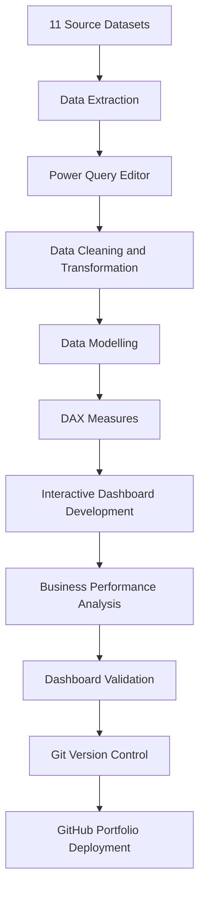
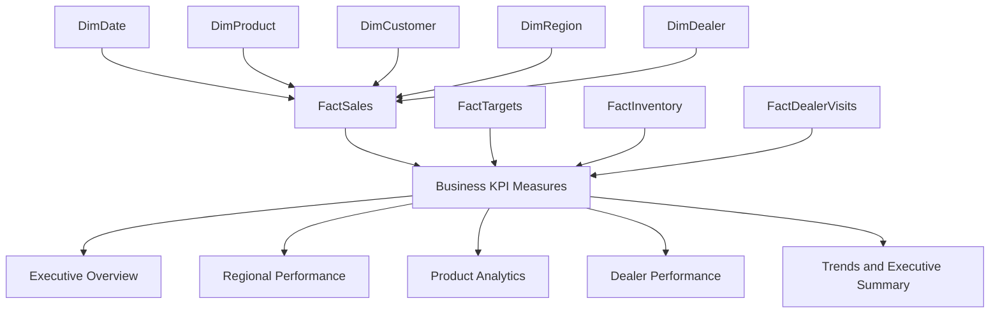

<div align="center">

# 🎨 ASIAN PAINTS SALES ANALYTICS

### End-to-End Power BI Business Intelligence Project


### Transforming Data into Actionable Business Insights

**300K Orders | 500 Products | 5,000 Dealers | 11 Datasets | 5 Interactive Dashboards**

[Project Overview](#-project-overview) •
[Dashboard Previews](#-dashboard-previews) •
[Business Insights](#-key-business-insights) •
[Download Project](#-download-power-bi-project)

</div>

---

## 📌 Project Overview

Asian Paints Sales Analytics is a comprehensive, end-to-end Business Intelligence project developed using Microsoft Power BI to analyze sales performance, profitability, regional contribution, product performance, dealer activity, and financial trends.

The project integrates 11 business datasets into five interactive dashboards, enabling users to explore business performance through dynamic visualizations, financial KPIs, advanced DAX calculations, and multidimensional analysis.

The dashboard is designed to demonstrate how raw business data can be transformed into meaningful insights that support strategic planning, operational monitoring, and data-driven decision-making.

---

## 🎯 Business Objectives

- Monitor overall revenue, profit, and sales performance.
- Evaluate revenue and profit against assigned business targets.
- Identify high-performing regions, states, and cities.
- Analyze product-level revenue and profitability.
- Evaluate dealer performance and distribution network productivity.
- Monitor regional and zone-wise profit margins.
- Analyze financial-year and previous-year performance.
- Track fiscal year-to-date revenue and profitability.
- Identify short-term revenue patterns using rolling averages.
- Deliver actionable insights through interactive executive dashboards.

---

## 📊 Executive KPI Summary

| Key Performance Indicator | Dashboard Value |
|:---|---:|
| 💰 Total Revenue | ₹701.66 Crore |
| 📈 Total Profit | ₹228.03 Crore |
| 📊 Profit Margin | 32.50% |
| 📦 Total Orders | 300,000 |
| 🎯 Revenue Target Achievement | 9.29% |
| 🏆 Profit Target Achievement | 15.00% |
| 📈 Reported Revenue YoY Comparison | +33.5% |
| 📈 Reported Profit YoY Comparison | +33.5% |
| 🎨 Selling Products | 500 |
| 🤝 Selling Dealers | 5,000 |
| 📍 Dealer Visits | 100,000 |
| 💵 Revenue per Dealer | ₹14.03 Lakh |
| 📦 Total Units Sold | 7,512,245 |
| 🔄 Units Sold / Average Stock | 48.07 |
| 📅 Fiscal YTD Revenue | ₹132.51 Crore |
| 📅 Fiscal YTD Profit | ₹43.06 Crore |

> KPI values represent the supplied project dataset under the displayed dashboard filter context.

---

## 🖥️ Dashboard Previews

The Power BI solution contains five interconnected dashboard pages with interactive navigation, dynamic slicers, conditional formatting, and business-specific analytical visualizations.

---

## 01. Executive Overview

<div align="center">


</div>

### Dashboard Purpose

Provides a centralized executive-level overview of overall sales performance, profitability, business targets, and geographical revenue distribution.

### Key Features

- Total Revenue KPI
- Total Profit KPI
- Profit Margin Percentage
- Total Orders
- Revenue Target Achievement
- Previous Year Performance Comparisons
- Monthly Revenue Trend
- Revenue vs Target Combination Chart
- Revenue by Product Category Treemap
- Geographical Revenue Distribution
- Executive Performance Scorecard
- Dynamic Business Summary

### Key Business Insights

- Total revenue reached approximately ₹701.66 crore.
- Total profit reached ₹228.03 crore.
- Overall profit margin remained at approximately 32.50%.
- The dashboard reports 300,000 orders.
- Revenue target achievement stands at 9.29%.
- Reported revenue and profit growth comparisons stand at approximately 33.5% under the displayed filter context.

### Business Value

Enables decision-makers to monitor overall business health, evaluate profitability, and identify potential gaps between actual performance and assigned targets.

---

## 02. Regional Performance

<div align="center">


</div>

### Dashboard Purpose

Analyzes geographical sales performance across regions, zones, states, and cities to identify regional contribution and profitability patterns.

### Key Features

- Regional Revenue Distribution
- Revenue by State Map
- Revenue by Region Ranking
- Top 7 States by Revenue
- Revenue vs Target by Region
- Region and Zone Profit Margin Heatmap
- Interactive Geographical Filters
- Regional Target Achievement Indicators

### Regional Revenue Ranking

| Rank | Region | Revenue |
|---:|:---|---:|
| 1 | West | ₹172.0 Cr |
| 2 | Central | ₹135.9 Cr |
| 3 | East | ₹135.8 Cr |
| 4 | North | ₹131.9 Cr |
| 5 | South | ₹126.1 Cr |

### Top 7 States by Revenue

| Rank | State | Revenue |
|---:|:---|---:|
| 1 | Mizoram | ₹55.5 Cr |
| 2 | Himachal Pradesh | ₹51.5 Cr |
| 3 | Rajasthan | ₹42.6 Cr |
| 4 | West Bengal | ₹42.0 Cr |
| 5 | Uttar Pradesh | ₹41.9 Cr |
| 6 | Tamil Nadu | ₹37.8 Cr |
| 7 | Odisha | ₹37.5 Cr |

### Regional Profit Margin Heatmap

The heatmap analyzes 15 Region–Zone combinations across five regions and three operational zones.

| Zone | Central | East | North | South | West |
|:---|---:|---:|---:|---:|---:|
| A | 32.52% | 32.55% | 32.57% | 32.49% | 32.47% |
| B | 32.56% | 32.58% | 32.44% | 32.45% | 32.52% |
| C | 32.46% | 32.43% | 32.55% | 32.42% | 32.50% |
| Total | 32.52% | 32.51% | 32.51% | 32.45% | 32.50% |

**Conditional Formatting:**

- 🟢 Green — Relatively higher profit margin
- 🟡 Yellow — Profit margin near the benchmark
- 🟠 Orange — Relatively lower profit margin

### Key Business Insights

- West is the highest revenue-generating region.
- Mizoram leads the displayed state-level revenue ranking.
- East Region, Zone B records the highest margin among the displayed combinations at 32.58%.
- South Region, Zone C records a comparatively lower margin of 32.42%.
- Regional profitability remains relatively consistent across the displayed operational zones.

### Business Value

Supports geographical performance monitoring, regional comparison, sales planning, and profitability analysis.

---

## 03. Product Analytics

<div align="center">


</div>

### Dashboard Purpose

Evaluates product-level sales performance, profitability, category contribution, and stock-related operational efficiency.

### Key Features

- Total Selling Products
- Top 7 Products by Revenue
- Top 7 Products by Profit
- Product Category Contribution
- Units Sold / Average Stock Analysis
- Product Revenue and Margin Scorecard
- Revenue vs Profit Scatter Chart
- Category, Subcategory, and Product Filters

### Product Portfolio

The dashboard analyzes seven product categories:

- Exterior Emulsion
- Interior Emulsion
- Industrial Coating
- Primer
- Putty
- Waterproofing
- Wood Finish

### Top 7 Products by Revenue

| Rank | Product | Revenue | Profit Margin |
|---:|:---|---:|---:|
| 1 | Asian Paint Product 399 | ₹1.67 Cr | 32.48% |
| 2 | Asian Paint Product 200 | ₹1.60 Cr | 33.04% |
| 3 | Asian Paint Product 222 | ₹1.58 Cr | 32.35% |
| 4 | Asian Paint Product 90 | ₹1.57 Cr | 32.16% |
| 5 | Asian Paint Product 162 | ₹1.57 Cr | 32.72% |
| 6 | Asian Paint Product 225 | ₹1.57 Cr | 33.06% |
| 7 | Asian Paint Product 144 | ₹1.56 Cr | 32.12% |

### Key Business Insights

- The dashboard analyzes 500 selling products.
- Total units sold exceed 7.5 million.
- Asian Paint Product 399 leads both revenue and profit rankings.
- Product 399 generates approximately ₹1.67 crore in revenue and ₹0.54 crore in profit.
- The units-sold-to-average-stock ratio stands at 48.07.
- Revenue and profit show a positive relationship among the displayed top-performing products.

> Units Sold / Average Stock is an operational proxy and not a conventional cost-based inventory turnover ratio.

### Business Value

Helps identify commercially important products, evaluate category contribution, compare product profitability, and support inventory planning.

---

## 04. Dealer Performance

<div align="center">


</div>

### Dashboard Purpose

Measures distribution network performance, dealer productivity, revenue contribution, and dealer visit activity.

### Key Features

- Dealer Revenue and Profit KPIs
- Total Selling Dealers
- Total Orders
- Revenue per Dealer
- Dealer Visit Monitoring
- Top 7 Dealers by Revenue
- Revenue per Dealer Type
- Dealer Visits Monthly Trend
- Selling Dealers by Type
- Revenue and Profit by Dealer Type
- Dealer Revenue by City Map
- Top 5 Cities by Dealer Revenue

### Dealer Network Summary

| Metric | Value |
|:---|---:|
| Total Selling Dealers | 5,000 |
| Total Dealer Visits | 100,000 |
| Revenue per Dealer | ₹14.03 Lakh |
| Total Dealer Revenue | ₹701.66 Cr |

### Top 7 Dealers by Revenue

| Rank | Dealer | Revenue |
|---:|:---|---:|
| 1 | Dewan Inc | ₹0.74 Cr |
| 2 | Kala and Sons | ₹0.60 Cr |
| 3 | Baral Ltd | ₹0.55 Cr |
| 4 | Dora Group | ₹0.51 Cr |
| 5 | Kala LLC | ₹0.50 Cr |
| 6 | Vaidya Inc | ₹0.49 Cr |
| 7 | Rajan Inc | ₹0.49 Cr |

### Top 5 Cities by Dealer Revenue

| Rank | City | Revenue |
|---:|:---|---:|
| 1 | Jamnagar | ₹4.75 Cr |
| 2 | Ghaziabad | ₹4.64 Cr |
| 3 | Burhanpur | ₹4.00 Cr |
| 4 | Aurangabad | ₹3.72 Cr |
| 5 | Khammam | ₹3.64 Cr |

### Key Business Insights

- Dewan Inc leads the dealer revenue ranking.
- Jamnagar generates the highest revenue among the displayed cities.
- Revenue per dealer averages approximately ₹14.03 lakh.
- The distribution network consists of 5,000 selling dealers.
- Dealer visits can be monitored through monthly trends.
- Dealer-type revenue and profitability comparisons support distribution network analysis.

### Business Value

Supports dealer performance evaluation, distribution planning, sales productivity monitoring, and identification of commercially important locations.

---

## 05. Trends & Executive Summary

<div align="center">


</div>

### Dashboard Purpose

Provides historical performance analysis, financial-year comparisons, cumulative fiscal reporting, and executive-level trend monitoring.

### Key Features

- Fiscal YTD Revenue
- Fiscal YTD Profit
- Profit Margin Percentage
- Revenue YoY Comparison
- Profit YoY Comparison
- Total Orders
- Revenue Trend vs Previous Year
- Profit Trend vs Previous Year
- Fiscal YTD Revenue Trend
- Three-Month Rolling Revenue Baseline
- Revenue and Profit Growth Trends
- Executive Category Scorecard
- Dynamic Executive Summary

### Financial Performance Summary

| Financial Indicator | Value |
|:---|---:|
| Fiscal YTD Revenue | ₹132.51 Cr |
| Fiscal YTD Profit | ₹43.06 Cr |
| Overall Profit Margin | 32.50% |
| Reported Revenue YoY | +33.5% |
| Reported Profit YoY | +33.5% |
| Total Orders | 300,000 |

### Key Business Insights

- Fiscal YTD revenue reached approximately ₹132.51 crore.
- Fiscal YTD profit reached approximately ₹43.06 crore.
- The current and previous-year trends support historical performance comparison.
- Monthly growth trends help identify periods of improving and declining performance.
- The three-month rolling baseline smooths short-term revenue fluctuations.
- Executive scorecards support category-level performance monitoring.

> The rolling three-month baseline represents a historical moving average, not a validated predictive forecast.

### Business Value

Enables financial performance monitoring, historical trend evaluation, fiscal reporting, and strategic decision support.

---

## 💡 Key Business Insights

| Business Area | Analytical Finding |
|:---|:---|
| Overall Revenue | ₹701.66 crore in recorded revenue |
| Profitability | ₹228.03 crore profit with 32.50% margin |
| Sales Volume | 300,000 recorded orders |
| Target Achievement | Actual revenue remains below assigned targets |
| Regional Leader | West region with ₹172 crore revenue |
| State Leader | Mizoram with ₹55.5 crore revenue |
| Product Leader | Asian Paint Product 399 |
| Dealer Leader | Dewan Inc |
| Dealer City Leader | Jamnagar |
| Product Portfolio | 500 selling products |
| Distribution Network | 5,000 selling dealers |
| Operational Activity | 100,000 dealer visits |
| Revenue Productivity | ₹14.03 lakh revenue per dealer |
| Inventory Analysis | 48.07 units-sold-to-average-stock ratio |
| Financial Monitoring | Fiscal YTD and rolling revenue analysis |

---

## 📈 Strategic Business Recommendations

### 1. Revenue and Target Optimization

- Investigate the difference between actual revenue and assigned targets.
- Validate target granularity and reporting-period alignment.
- Establish appropriate regional and category-level performance benchmarks.
- Monitor revenue achievement through monthly performance reviews.

### 2. Regional Sales Development

- Evaluate the sales strategies associated with the West region's performance.
- Investigate comparatively lower revenue contribution in the South region.
- Monitor profitability across operational zones.
- Validate geographical classifications before making location-specific decisions.

### 3. Product Portfolio Optimization

- Prioritize commercially strong products.
- Evaluate high-margin product opportunities.
- Review category-level revenue contribution.
- Align stock planning with product demand.

### 4. Dealer Network Development

- Monitor high-performing dealers and dealer types.
- Evaluate revenue productivity across the distribution network.
- Monitor dealer visit activity.
- Identify opportunities to improve dealer contribution.

### 5. Financial Performance Monitoring

- Use comparable financial-year periods for YoY analysis.
- Monitor revenue and profit growth alongside target achievement.
- Track rolling historical revenue benchmarks.
- Review fiscal YTD performance regularly.

---

## 🗂️ Dataset Overview

The project incorporates 11 business datasets covering sales transactions, products, customers, dealers, geographical attributes, inventory, marketing, and financial targets.

| Dataset | Business Purpose |
|:---|:---|
| FactSales | Sales transactions and financial performance |
| FactTargets | Revenue and profit target information |
| FactInventory | Inventory and stock analysis |
| FactDealerVisits | Dealer visit activity |
| DimDate | Date dimension and fiscal time intelligence |
| DimProduct | Product and category information |
| DimCustomer | Customer-related information |
| DimDealer | Dealer details and segmentation |
| DimRegion | Region, Zone, State, and City information |
| ProductCostMaster | Product cost information |
| MarketingCampaigns | Marketing campaign information |

---

## 🛠️ Tools and Technologies

| Technology | Application |
|:---|:---|
| Microsoft Power BI Desktop | Interactive dashboard development |
| Power Query | Data extraction and transformation |
| M Language | Data preparation logic |
| DAX | Business calculations and KPI measures |
| Data Modelling | Fact and dimension relationships |
| Time Intelligence | Fiscal YTD and previous-year comparisons |
| Conditional Formatting | Profitability and performance indicators |
| CSV | Source datasets |
| Git | Version control and project deployment |
| GitHub | Portfolio hosting and documentation |

---

## ⚙️ End-to-End Data Analytics Workflow



---

## 🧹 Data Cleaning and Transformation

The data preparation stage focused on transforming raw CSV datasets into structured, analysis-ready business information.

### Power Query Workflow

- Import multiple CSV datasets.
- Review source data and column structures.
- Configure appropriate column data types.
- Prepare date and financial fields.
- Organize transactional and dimensional attributes.
- Prepare product and geographical categories.
- Support consistent financial calculations.
- Validate dataset loading and refresh behavior.

Power Query Applied Steps preserve the transformation workflow for review and reproducibility.

---

## 🔗 Data Modelling

The project follows a fact-and-dimension analytical modelling approach to enable filtering and aggregation across different business dimensions.

### Conceptual Data Model



> This diagram represents the conceptual analytical architecture. Detailed model relationships are available inside the Power BI project.

### Modelling Benefits

- Consistent business KPI calculations.
- Multidimensional analytical filtering.
- Financial-year and monthly reporting.
- Product and geographical performance analysis.
- Dealer network performance evaluation.
- Reusable business calculations.

---

## 🧮 DAX Measures and Business Calculations

The project incorporates DAX-based financial, operational, and time-intelligence calculations.

### Core Business Measures

| Measure | Calculation Logic |
|:---|:---|
| Total Revenue | Sum of net sales |
| Total Profit | Aggregation of sales profit |
| Profit Margin % | Total Profit / Total Revenue |
| Revenue in Crore | Total Revenue / 10,000,000 |
| Profit in Crore | Total Profit / 10,000,000 |
| Revenue Target Achievement | Actual Revenue / Revenue Target |
| Profit Target Achievement | Actual Profit / Profit Target |
| Revenue YoY % | Revenue change relative to prior-year revenue |
| Profit YoY % | Profit change relative to prior-year profit |
| Fiscal YTD Revenue | Cumulative revenue within the fiscal year |
| Fiscal YTD Profit | Cumulative profit within the fiscal year |
| Revenue per Dealer | Revenue / Selling Dealers |
| Units Sold / Average Stock | Operational stock-efficiency proxy |
| Rolling 3-Month Revenue | Historical moving revenue average |
| Margin Heatmap Color | Conditional profitability classification |

### Representative DAX Calculation Logic

The following examples illustrate the calculation principles used in the analytical solution.

#### Profit Margin

```dax
Profit Margin =
DIVIDE(
    [Total Profit],
    [Total Revenue],
    0
)
```

#### Revenue Target Achievement

```dax
Target Achievement =
DIVIDE(
    [Total Revenue],
    [Revenue Target],
    0
)
```

#### Revenue Year-over-Year Growth

```dax
Revenue YoY =
DIVIDE(
    [Total Revenue] - [Revenue PY],
    [Revenue PY]
)
```

#### Revenue in Crore

```dax
Revenue Cr =
DIVIDE(
    [Total Revenue],
    10000000
)
```

> These examples demonstrate calculation logic. Exact measure definitions and field names can be reviewed inside the PBIX file.

---

## 📅 Time Intelligence

The dashboard incorporates financial time-intelligence techniques to support historical and cumulative business performance analysis.

### Features

- Financial Year Slicers
- Year and Month Slicers
- Previous Year Revenue
- Previous Year Profit
- Revenue Growth Percentage
- Profit Growth Percentage
- Fiscal Year-to-Date Revenue
- Fiscal Year-to-Date Profit
- Monthly Revenue Trends
- Three-Month Rolling Revenue Baseline

The Indian financial-year reporting convention of April to March is used for fiscal reporting.

When prior-year data is unavailable, the growth comparison is displayed as unavailable rather than presenting misleading zero growth.

---

## 🎨 Dashboard Design and User Experience

The project uses a consistent executive dashboard interface inspired by the Asian Paints brand identity.

### Design Features

- Professional navy-blue navigation sidebar.
- Consistent white KPI cards.
- Business-specific icons.
- Interactive page navigation.
- Financial-year and monthly slicers.
- Page-specific analytical filters.
- Reset Filters buttons.
- Conditional performance formatting.
- Regional profitability heatmap.
- Revenue and profit color differentiation.
- Professional chart spacing and alignment.
- Indian currency formatting in Crore and Lakh.
- Dynamic executive summary sections.

The dashboard emphasizes clarity, readability, consistency, and practical business interpretation.

---

## 🔄 Interactive Dashboard Functionality

| Functionality | Description |
|:---|:---|
| Financial Year Filter | Analyze individual financial periods |
| Year Month Filter | Explore monthly performance |
| Category Filter | Analyze product categories |
| Regional Filters | Explore regions, zones, states, and cities |
| Dealer Filters | Evaluate dealer-specific performance |
| Product Filters | Analyze individual products |
| Page Navigation | Navigate between five dashboard pages |
| Reset Filters | Restore default filtering conditions |
| Conditional Formatting | Highlight relative performance |
| Data Refresh | Reload data from configured sources |

---

## ✅ Project Validation

The completed dashboard was reviewed for:

- KPI value visibility and alignment.
- Financial-year slicer functionality.
- Previous-year comparison behavior.
- Profit margin heatmap functionality.
- Region and zone combinations.
- Conditional formatting.
- Product and dealer ranking presentation.
- Rolling revenue baseline visualization.
- Dashboard navigation.
- Reset Filters functionality.
- Successful Power BI data refresh.
- Git-based repository upload.

---

## 📁 Repository Structure

```text
ASIAN_PAINTS_SALES_ANALYTICS/
│
├── ASSETS/
│   ├── EXECUTIVE OVERVIEW.png
│   ├── REGIONAL PERFORMANCE.png
│   ├── PRODUCT ANALYTICS.png
│   ├── DEALER PERFORMANCE.png
│   └── TRENDS & EXECUTIVE SUMMARY.png
│
├── DATASETS/
│   └── Project Source Datasets
│
├── ASIAN_PAINTS_SALES_ANALYTICS.pbix
│
└── README.md
```

---

## 📥 Download Power BI Project

<div align="center">

[](https://github.com/raki265-official-ai/ASIAN_PAINTS_SALES_ANALYTICS/raw/refs/heads/main/ASIAN_PAINTS_SALES_ANALYTICS.pbix)

**Complete Interactive Power BI Dashboard**

**File Format: PBIX | File Size: Approximately 34.43 MB**

</div>

### How to Run the Project

1. Download the PBIX file from the repository.
2. Install Microsoft Power BI Desktop.
3. Open `ASIAN_PAINTS_SALES_ANALYTICS.pbix`.
4. Explore the five interactive dashboard pages.
5. Use slicers to analyze different business segments.
6. Download the source datasets if a data refresh is required.
7. Update the CSV source paths through Power Query or Data Source Settings.
8. Click Refresh to reload the data.

### Clone the Repository

```bash
git clone https://github.com/raki265-official-ai/ASIAN_PAINTS_SALES_ANALYTICS.git
```

---

## 🚀 Skills Demonstrated

- Business Intelligence
- Business Analytics
- Exploratory Data Analysis
- Data Cleaning and Transformation
- Power Query
- M Language
- Dimensional Data Modelling
- DAX Calculations
- Financial Time Intelligence
- Sales and Profitability Analysis
- Product Performance Analysis
- Regional Performance Analysis
- Dealer Performance Analysis
- Financial KPI Monitoring
- Interactive Dashboard Development
- Data Visualization
- Data Storytelling
- Business Problem Solving
- Git Version Control
- GitHub Portfolio Deployment

---

## 🔮 Future Enhancements

Potential future improvements include:

- Automated data refresh.
- Additional data quality validation.
- Verified geographical classifications.
- Advanced product demand analysis.
- Dealer segmentation analysis.
- Marketing campaign effectiveness analysis.
- Validated forecasting models.
- Power BI Service deployment.
- Role-based dashboard access.
- Additional mobile-friendly dashboard layouts.

---

## 📝 Data Interpretation and Disclaimer

This project is an independent educational and portfolio analytics project inspired by Asian Paints.

The dashboard metrics represent the supplied project datasets and should not be interpreted as verified financial results of Asian Paints Limited.

Geographical classifications are retained from the supplied datasets and may contain inconsistencies.

Aggregate previous-year comparisons may be affected by differences in reporting-period coverage. Comparable financial-year selections should be used for meaningful YoY analysis.

The rolling revenue baseline represents historical analysis and is not a validated predictive forecast.

This project is not officially affiliated with or endorsed by Asian Paints Limited.

---

## 👨‍💻 Project Author

**Rakesh Pedduri**

**Domain:** Data Analytics | Business Intelligence

**Project:** Asian Paints Sales Analytics

**Platform:** Microsoft Power BI

**GitHub:** [raki265-official-ai](https://github.com/raki265-official-ai)

---

<div align="center">

## ⭐ Support This Project

If you find this project useful, consider giving the repository a star.

### Turning Data Into Insights.
### Turning Insights Into Business Decisions.


**Thank You for Visiting My Project!**

</div>
